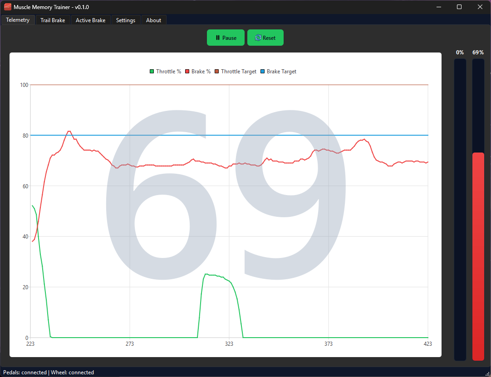
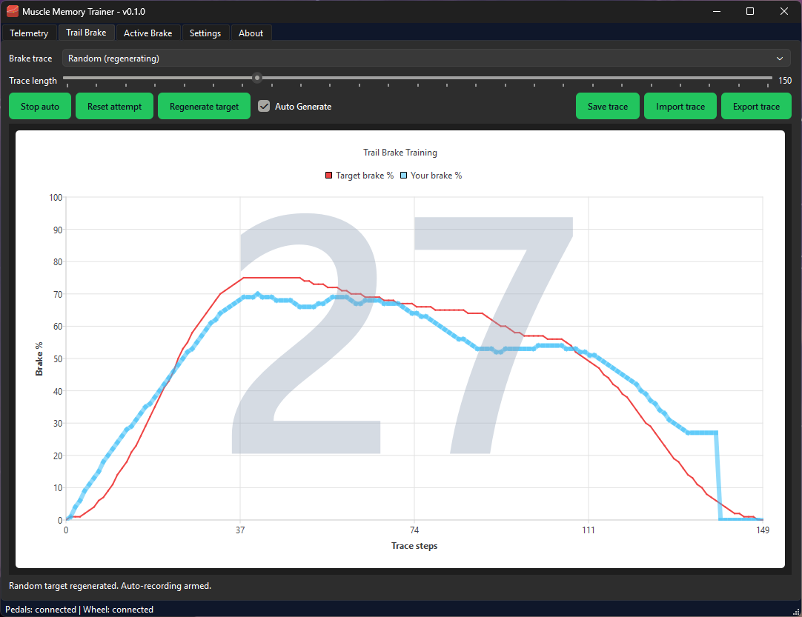
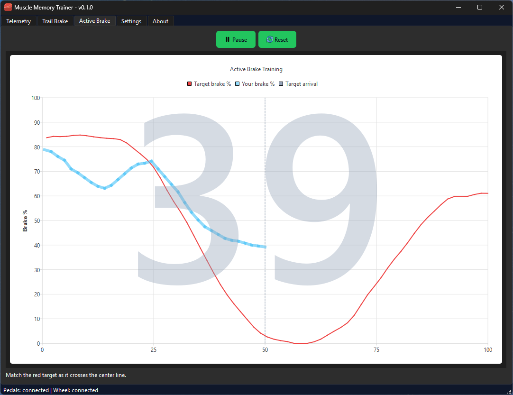
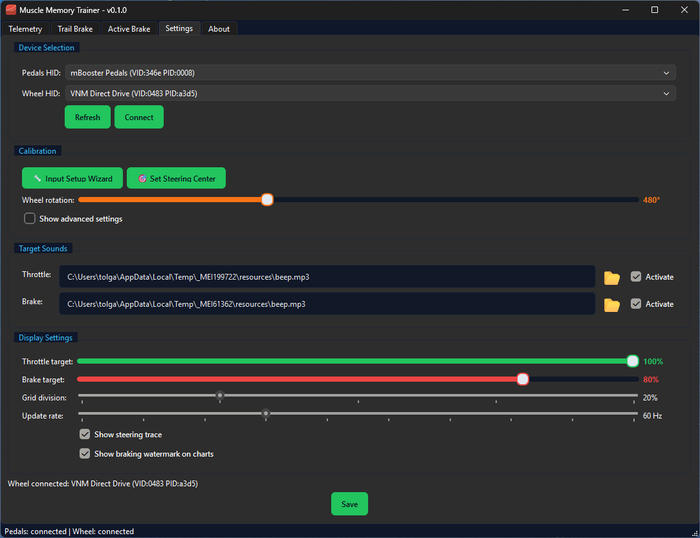

# Muscle Memory Trainer

A PySide6 desktop application for sim racers to practice throttle, brake, and steering muscle memory with live telemetry visualization, HID device calibration, and training modes.


[](https://buymeacoffee.com/tlgylmz)

## Screenshots

| Telemetry | Static Brake Training |
|:---------:|:---------------------:|
|  |  |

| Active Brake Training | Settings |
|:---------------------:|:--------:|
|  |  |

And more to come...

## Table of Contents

- [Features](#features)
- [Installation](#installation)
  - [End Users](#end-users)
  - [Developers](#developers)
- [Usage](#usage)
- [Building from Source](#building-from-source)
- [Project Structure](#project-structure)
- [Architecture](#architecture)
- [Configuration](#configuration)
- [Testing](#testing)
- [Contributing](#contributing)
- [Troubleshooting](#troubleshooting)
- [Support](#support)
- [Dependencies](#dependencies)
- [License](#license)

---

## Features

- **Live Telemetry Chart**: Real-time visualization of throttle, brake, and steering inputs with target lines (steering can be toggled)
- **HID Device Support**: Connect pedals and wheels via USB HID with auto-detection and calibration
- **Trail Brake Training**: Practice following brake traces with a score for every attempt; keep your own trace library (save, import, export, delete)
- **Active Brake Training**: React to dynamically moving targets with adjustable speed and a live accuracy score
- **Threshold Training**: Hit floating brake-pressure targets; tracks hits, misses and streaks
- **Audio Cues**: Optional sound notifications when targets are hit (preview and custom sounds in Settings)
- **Keyboard Shortcuts**: `Space` to start/pause, `R` to reset
- **Persistent Settings**: All configurations saved automatically between sessions

---

## Installation

### End Users

Download the latest release from the [Releases](../../releases) page and run `MuscleMemoryTrainer.exe`. No installation required.

### Developers

#### Prerequisites

- Python 3.10 or higher
- Windows (for packaging; development works on all platforms)
- Optional: HID-compatible pedals/wheel (app simulates input without hardware)

#### Setup

```powershell
# Clone the repository
git clone https://github.com/yourusername/MuscleMemoryTrainer.git
cd MuscleMemoryTrainer

# Create and activate virtual environment
python -m venv .venv
.\.venv\Scripts\Activate.ps1  # Windows PowerShell
# or: source .venv/bin/activate  # Linux/macOS

# Install in editable mode with dev dependencies
pip install -e ".[dev]"

# Run the application
python -m mmt_app
```

---

## Usage

1. **Connect Devices**: Go to the Settings tab and pick your pedals/wheel from the dropdown menus; they connect immediately. The status bar shows which devices are live, or *Simulated input* when none are.
2. **Calibrate**: Use the calibration wizards to set axis ranges and offsets
3. **Select Training Mode**:
   - **Telemetry**: View live input visualization
   - **Trail Brake**: Follow a brake trace; each attempt is scored (last / best / average)
   - **Active Brake**: Match a scrolling target at the center line; live accuracy is shown
   - **Threshold Training**: Hold the brake at each target's value as it reaches the dashed line; hits, misses and streaks are counted
4. **Adjust Settings**: Configure update rates, sound cues, and visual options. Everything is saved automatically.

### Keyboard Shortcuts

| Key | Action (on Telemetry and training tabs) |
|-----|------------------------------------------|
| `Space` | Start / pause |
| `R` | Reset |

Training sessions pause automatically when you switch to another tab.

### Scoring

Trail Brake and Active Brake scores are `100 − average difference from the target` (in % points); time where both you and the target are at 0% is ignored. In Threshold Training a target counts as a hit when your brake is within ±5% of its value as it crosses the dashed line.

---

## Building from Source

### Development Build

```powershell
# Run directly from source
python -m mmt_app
```

### Standalone Executable (PyInstaller)

```powershell
# Build using the provided spec file
pyinstaller --clean --noconfirm mmt_app.spec
```

**Output**: `dist/MuscleMemoryTrainer/MuscleMemoryTrainer.exe` (one-folder build)

### VS Code Integration

The project includes pre-configured VS Code tasks and launch configurations for common operations.

#### Using Tasks (Ctrl+Shift+P → "Tasks: Run Task")

| Task | Description |
|------|-------------|
| `PyInstaller build` | Build the executable |
| `PyInstaller clean build` | Clean build (removes cache first) |
| `Run tests` | Run pytest with verbose output |

#### Using Run/Debug Menu (F5 or Ctrl+Shift+D)

| Configuration | Description |
|---------------|-------------|
| `Run MuscleMemoryTrainer` | Launch the app with debugger attached |
| `Build` | Run PyInstaller build with debugger |
| `Clean Build` | Run PyInstaller clean build with debugger |
| `Run Tests` | Run pytest with debugger attached |

#### Build Options

| Option | How to Enable | Notes |
|--------|---------------|-------|
| One-file mode | Set `onefile=True` in `mmt_app.spec` | Slower startup, single portable exe |
| Custom icon | Replace `src/mmt_app/resources/appicon.ico` | Appears in Explorer and taskbar |
| Debug console | Set `console=True` in `mmt_app.spec` | Shows stdout/stderr window |

---

## Project Structure

```
MuscleMemoryTrainer/
├── src/mmt_app/              # Main application package
│   ├── __init__.py           # Package initialization
│   ├── __main__.py           # Module entry point
│   ├── main.py               # CLI and PyInstaller entry point
│   ├── app.py                # Qt application bootstrap
│   ├── config.py             # Configuration management (dataclasses)
│   ├── telemetry.py          # Telemetry data handling
│   ├── trail_brake.py        # Brake trace generation and scoring
│   ├── input/                # HID device handling
│   │   ├── __init__.py
│   │   ├── hid_backend.py    # HID session management
│   │   └── calibration.py    # Device calibration logic
│   ├── ui/                   # User interface components
│   │   ├── __init__.py
│   │   ├── main_window.py    # Main application window
│   │   ├── settings_tab.py   # Device & settings configuration
│   │   ├── trail_brake_tab.py    # Trail brake training
│   │   ├── active_brake_tab.py   # Active brake training
│   │   ├── threshold_training_tab.py  # Threshold training
│   │   ├── telemetry_chart.py    # Chart visualization
│   │   ├── watermark_chart_view.py
│   │   └── utils.py          # UI utility functions
│   └── resources/            # Assets (icons, styles, sounds)
│       ├── app.qrc           # Qt resource collection
│       ├── appicon.ico       # Application icon
│       ├── beep.mp3          # Notification sound
│       └── styles/
│           └── theme.qss     # Application stylesheet
├── tests/                    # Test suite
│   ├── test_config.py        # Configuration tests
│   ├── test_trail_brake.py   # Brake trace algorithm and scoring tests
│   ├── test_ui_regressions.py  # Training tab and sound settings behaviour
│   ├── test_utils.py         # Utility function tests
│   └── test_smoke.py         # Basic smoke tests
├── mmt_app.spec              # PyInstaller build specification
├── pyproject.toml            # Project metadata and dependencies
└── README.md                 # This file
```

---

## Architecture

The application follows **SOLID principles** with a clean separation of concerns:

### UI Layer (`ui/`)
- **MainWindow**: Orchestrates tabs and coordinates updates via callbacks
- **SettingsTab**: Device selection, calibration wizards, sound settings
- **TrailBrakeTab**: Trace selection, recording, scoring, trace library
- **ActiveBrakeTab**: Dynamic target training
- **ThresholdTrainingTab**: Floating threshold targets with hit/miss scoring
- **TelemetryChart**: Real-time data visualization

### Domain Layer
- **config.py**: Immutable dataclasses for configuration (`InputProfile`, `PedalsConfig`, `WheelConfig`, `UiConfig`)
- **trail_brake.py**: Trace generation with `BrakeTrace`, interpolation, smoothing, jitter functions, and `trace_accuracy` scoring
- **telemetry.py**: Input data processing

### Input Layer (`input/`)
- **HidSession**: Raw HID device communication
- **calibration.py**: Axis calibration algorithms

### Design Patterns Used
- **Callback Pattern**: Loose coupling between tabs and main window
- **Factory Functions**: `create_application()`, `create_main_window()`
- **Immutable Dataclasses**: Configuration objects are frozen for thread safety
- **Single Responsibility**: Each class has one clear purpose

---

## Configuration

Settings are persisted to `config.ini` in your user config directory:
- **Windows**: `%LOCALAPPDATA%/MuscleMemoryTrainer/`
- **Linux**: `~/.config/MuscleMemoryTrainer/`
- **macOS**: `~/Library/Application Support/MuscleMemoryTrainer/`

### Stored Settings

| Category | Settings |
|----------|----------|
| Devices | Vendor/product IDs, report lengths, byte offsets |
| Calibration | Axis min/max values, center points |
| UI | Update rate, grid visibility, steering visibility, window size, last open tab |
| Training | Target values, selected traces |
| Audio | Custom sound file paths (empty = built-in beep), enable/disable flags |

Your saved brake traces live next to `config.ini` in `custom_traces.json`.

---

## Testing

The project uses **pytest** with 155+ tests covering configuration, calibration, telemetry, algorithms, and utilities.

```powershell
# Run all tests
pytest

# Run with verbose output
pytest -v

# Run specific test file
pytest tests/test_calibration.py

# Run with coverage (requires pytest-cov)
pytest --cov=src/mmt_app --cov-report=html
```

**VS Code**: Use `Ctrl+Shift+P` → "Tasks: Run Task" → "Run tests", or press `F5` and select "Run Tests" to debug tests.

### Test Categories

| File | Coverage |
|------|----------|
| `test_config.py` | Configuration save/load, dataclass validation |
| `test_trail_brake.py` | Trace generation, interpolation, smoothing, scoring |
| `test_ui_regressions.py` | Training tabs, trace library, sound settings |
| `test_utils.py` | Axis scaling, clamping, resource paths |
| `test_smoke.py` | Basic application startup checks |

---

## Contributing

Contributions are welcome! Please follow these guidelines:

### Development Workflow

1. **Fork** the repository
2. **Create a feature branch**: `git checkout -b feature/your-feature-name`
3. **Make changes** following the code style
4. **Add tests** for new functionality
5. **Run tests**: `pytest`
6. **Run linter**: `ruff check src/ tests/`
7. **Run type checker**: `mypy src/`
8. **Commit** with descriptive messages
9. **Push** and create a Pull Request

### Code Style

- **Formatter**: Use `ruff format` (configured in `pyproject.toml`)
- **Linter**: Use `ruff check` with rules E, F, I
- **Type Hints**: All public functions should have type annotations
- **Docstrings**: Use Google-style docstrings for classes and public methods
- **Line Length**: 100 characters max

### Adding New Features

- Follow the existing tab pattern for new training modes
- Use callbacks for communication between UI components
- Create immutable dataclasses for new configuration types
- Add tests for all new functionality

---

## Troubleshooting

### Common Issues

| Problem | Solution |
|---------|----------|
| **HID input not detected** | Ensure `hidapi` is installed (`pip install hidapi`). The app falls back to simulated input if unavailable. |
| **Blank window in packaged build** | Verify `dist/MuscleMemoryTrainer/resources/` exists with styles, sounds, and icons. |
| **Application won't start** | Check Python version (3.10+ required). Try `python -m mmt_app` for error messages. |
| **Calibration issues** | Use the calibration wizard in Settings tab. Ensure device is connected before calibrating. |
| **No sound** | Check that sound files exist in resources and audio is enabled in Settings. |

### Debug Mode

Run with console output to see errors:

```powershell
# Development
python -m mmt_app

# Or modify mmt_app.spec: set console=True, rebuild
```

### Reporting Issues

When reporting bugs, please include:
- Operating system and version
- Python version (`python --version`)
- Steps to reproduce
- Error messages (if any)
- HID device model (if relevant)

---

## Dependencies

### Runtime
- **PySide6** (≥6.7): Qt for Python GUI framework
- **hidapi** (≥0.14): Cross-platform HID device access

### Development
- **pytest** (≥7.4): Testing framework
- **ruff** (≥0.6): Linter and formatter
- **mypy** (≥1.11): Static type checker
- **pyinstaller** (≥6.6): Executable packaging

---

## Support

If you find this tool helpful and would like to support its development, you can buy me a coffee:

[](https://buymeacoffee.com/tlgylmz)

## License

This project is licensed under the MIT License - see the [LICENSE](LICENSE) file for details.

---

## Acknowledgments

- Built with [PySide6](https://doc.qt.io/qtforpython/) (Qt for Python)
- HID support via [hidapi](https://github.com/libusb/hidapi)
